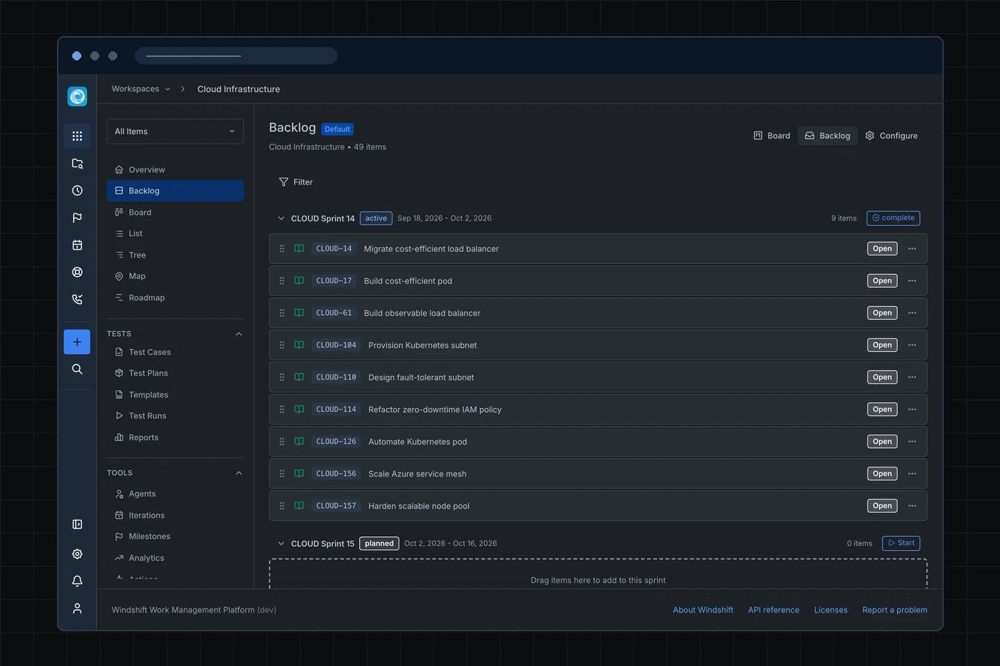
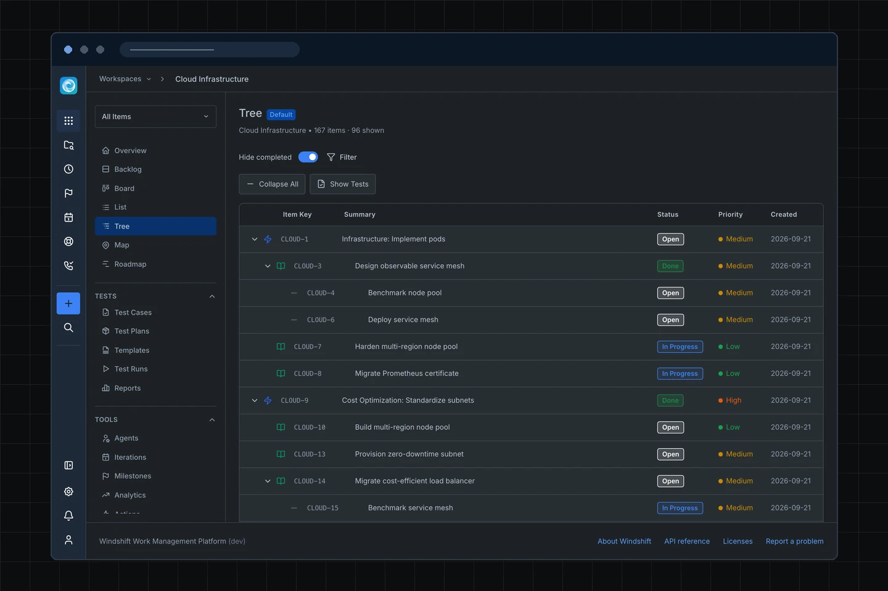
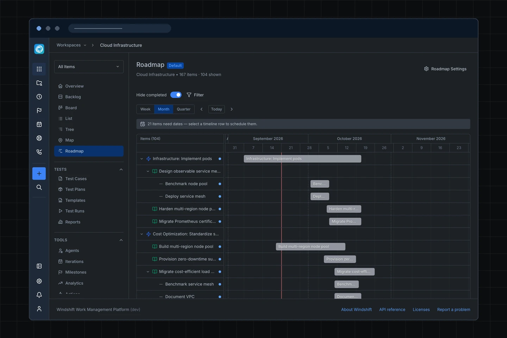
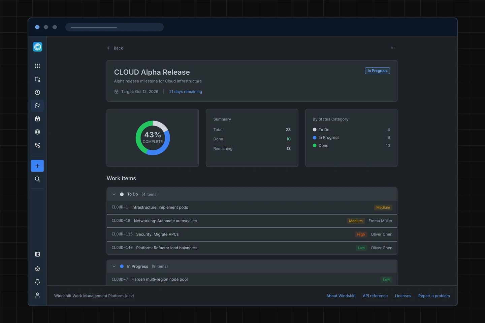
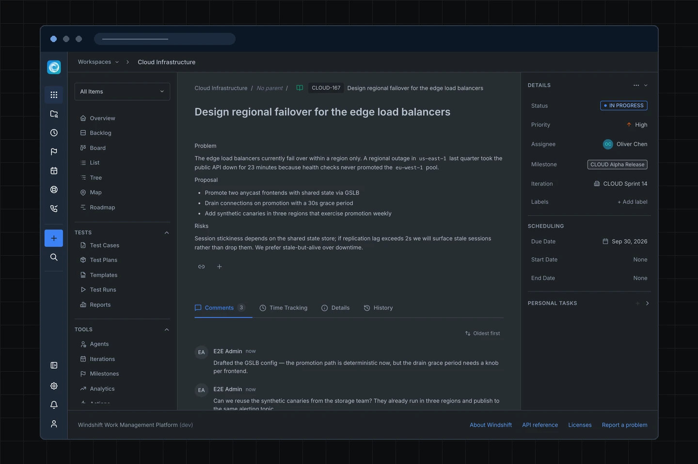
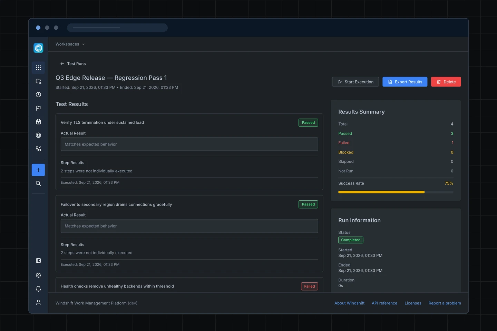
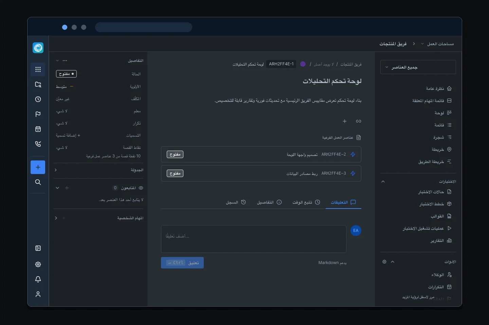

<p align="center">
  <picture>
    <source media="(prefers-color-scheme: light)" srcset=".github/assets/readme-splash.svg">
    
  </picture>
</p>

<p align="center">
  <a href="https://windshift.sh/download"></a>
  <a href="https://sandbox.demo.windshift.app/try-demo"></a>
  <a href="LICENSE"></a>
  <a href="https://windshift.sh/docs"></a>
  <a href="https://matrix.to/#/%23windshift:matrix.org"></a>
  <a href="https://github.com/Windshiftapp/core/stargazers"></a>
  <a href="https://github.com/Windshiftapp/core/releases/latest"></a>
</p>

<p align="center">Windshift is an open-source, self-hosted work management platform and a Jira alternative, licensed under AGPL v3. It runs as a single Go binary with the Svelte frontend built in, using embedded SQLite by default or PostgreSQL, and ships as an official Docker image and a desktop app. See <a href="https://windshift.sh">windshift.sh</a> and the <a href="https://windshift.sh/docs">documentation</a>.</p>

<p align="center">
  <picture>
    <source media="(prefers-color-scheme: light)" srcset=".github/assets/screenshots/hero-board-framed.webp">
    
  </picture>
</p>

## What Windshift is

Windshift is a work management platform for teams who want Jira's depth without Jira's weight.

It covers the core of what Jira does: projects, epics, stories, sub-tasks, sprints and backlogs, boards, roadmaps, custom workflows, custom fields, screens, permissions, automation, and dashboards. Filtering and saved searches use Windshift Query Language, a JQL-style query language.

It also replaces the add-ons and adjacent tools you would otherwise stitch together: service management with SLAs and a customer portal, a knowledge base, test management, time tracking, and an asset/CMDB register.

A built-in importer handles the move off Jira.

It ships as a single Go binary with the Svelte frontend built in, SQLite by default or PostgreSQL for data storage. No Java, no Elasticsearch cluster, no per-user pricing, and your data stays on your infrastructure.

## Highlights

- Plan Jira-style without the Jira footprint: boards, backlogs, sprints, epics and sub-tasks, hierarchy trees, roadmaps, and dashboards.
- Configure each workspace on its own: item types, custom fields, screens, statuses, workflows, priorities, and permissions.
- Filter with a JQL-style query language and save the results as shared views.
- Automate the busywork with event-driven rules that update fields, notify people, and create work.
- Serve customers with SLAs, queues, approvals, and a public request portal.
- Connect GitHub, GitLab, Gitea, and Forgejo, import Jira projects, and send email or webhook notifications.
- Extend it with test management, time tracking, a knowledge base, or an asset register.

## Coming from Jira

| Jira | Windshift |
|------|-----------|
| Projects | Workspaces and collections |
| Issues, epics, sub-tasks | Work items with configurable hierarchy levels |
| Boards, backlogs, sprints | Board and backlog views with iterations |
| Custom fields and screens | Custom fields and screens |
| Workflows and statuses | Workflow builder with conditions and approvals |
| JQL and saved filters | Windshift Query Language and saved collections |
| Jira Automation | Built-in event-driven actions |
| Jira Service Management | SLAs, queues, approvals, and a customer portal |
| Jira Assets / Insight | Asset and CMDB register |
| Xray / Zephyr | Test cases, test sets, test runs, and reports |
| Marketplace apps | Built-in modules, packs, and plugins (extensible via WASM runtime) |

<details>
<summary>Full feature list</summary>

**Planning and tracking**

- Workspaces, collections, and configurable hierarchy levels: epics, stories, sub-tasks, and custom item types.
- Boards, backlogs, sprints and iterations, roadmaps, milestones, dashboards, and hierarchy tree views.
- Custom fields, screens, statuses, workflows, priorities, and per-workspace permissions.
- Windshift Query Language (JQL-style) filters, saved collections, and links between work items.

**Service management**

- Service level agreements, queues, approvals, and a public customer request portal.
- Request types and SLA reporting.

**Test management**

- Test cases, test sets, test runs, per-case results, and release reports.

**Time tracking**

- Time projects, worklogs, timers, and reporting.

**Knowledge base**

- Pages with revisions, permissions, diagrams, and search.

**Assets and CMDB**

- Asset sets, asset types, custom fields, and reports.

**Automation**

- Event-driven rules that update fields, notify people, and create work.
- Actions with conditions, templates, and validation.

**Integrations and API**

- GitHub, GitLab, Gitea, and Forgejo source control with pull request linking.
- Jira importer, email and webhook notifications, SMTP/IMAP, LDAP, and OIDC single sign-on.
- MCP server with OAuth, REST API v2, and a WASM plugin runtime.

**Internationalization**

- Thirteen built-in languages: English, Deutsch, Español, Français, Italiano, Nederlands, Polski, Português (Brasil), العربية, فارسی, Русский, 简体中文, and 한국어, with right-to-left support for Arabic and Persian.

</details>

## Agents and automation

Windshift runs coding agents against your repositories. Agent Studio binds an agent to a workspace, launches it from a work item, and links the resulting pull request back to that item. Source control integrations cover GitHub, GitLab, Gitea, and Forgejo.

The built-in MCP server exposes work items, comments, pages, knowledge, tests, time tracking, and actions over the Model Context Protocol, with OAuth so agents and assistants authenticate as a real user and inherit that user's permissions.

### MCP tools

Enable MCP with `--mcp` or `MCP_ENABLED=true`. Connect a Streamable HTTP client to your Windshift instance at `/mcp` using OAuth or a personal access token. The token needs `mcp:access` and the resource scopes required by each tool. Windshift also checks the user's workspace and resource permissions.

**Review delivery and booked time**

1. Call `get_task_delivery_summary` with `{"item_keys":["PROJ-42"]}` for status, assignee, estimate, visible booked time by contributor, time in each workflow state, and links to recorded outcome evidence. A call can cover up to 20 tasks.
2. Call `get_delivery_effort_report` with `{"iteration_id":7}` to use the sprint's dates. For a workspace or saved collection, supply `workspace_id` or `collection_id` and inclusive local `from` and `to` dates. Use the `variance` or `coverage` view to find tasks over estimate or tasks completed in the period with no visible worklogs. A report can cover up to 5,000 visible tasks.
3. Follow the evidence with `list_item_worklogs`, `list_project_worklogs`, `get_comment`, or `list_item_test_results`. Project worklogs can be filtered by logger and include bookings with no linked task. Use the `result_id` from a delivery summary to retrieve one linked QA result.

Task delivery and effort reads require `items:read` and `time:read`. A sprint report also requires `iterations:read`, and a collection report also requires `collections:read`. QA evidence requires `tests:read` and permission to view the tests. Ordinary project contributors see their own worklogs, and project managers can see other contributors' bookings in projects they manage.

**Make a targeted update**

Booking and worklog corrections require `time:write`. Item edits, watch changes, and internal comments require `items:write`.

- Find a bookable project with `list_time_projects`. When calling `log_time`, use a stable `idempotency_key` for each intended booking and reuse that key and the same arguments when retrying.
- Use `list_time_drafts` to find a draft's ID, version, and missing fields. Pass the ID, version, and a retry key to `book_time_draft`. To correct a saved entry, use `get_worklog` and pass the expected current values to `edit_my_worklog`.
- Follow or unfollow a ticket with `set_my_item_watch`, post a staff-only note using `add_comment` with `internal: true`, or pass the current `updated_at` as `expected_updated_at` to `update_item` when making an estimate or other field edit.

<details>
<summary>Read tools by workflow</summary>

- **Delivery and time** — `get_task_delivery_summary`, `get_delivery_effort_report`, `get_item_time_rollup`, `list_item_worklogs`, `list_project_worklogs`, `get_worklog_totals`, `get_worklog`, `get_active_timer`, `list_time_drafts`, `get_time_project_budget`
- **Item history and evidence** — `list_item_history`, `list_item_transitions`, `get_item_status_durations`, `list_item_scm_links`, `get_comment`, `list_item_attachments`, `read_item_attachment_text`, `list_item_test_results`
- **Planning and workload** — `list_collections`, `list_collection_items`, `get_iteration_progress`, `get_iteration_burndown`, `get_milestone_progress`, `list_milestone_activity`, `get_delivery_flow_metrics`, `get_item_dependencies`, `get_item_hierarchy`, `get_my_work_overview`, `get_assignment_load`, `list_my_completed_items`
- **Support and collaboration** — `list_queues`, `list_queue_items`, `get_item_sla`, `get_support_metrics`, `list_my_approvals`, `list_my_notifications`, `list_my_reviews`, `get_item_watchers`, `list_item_request_participants`
- **Forms, operations, and QA** — `get_item_form_fields`, `list_item_templates`, `list_actions`, `list_action_logs`, `list_item_agent_runs`, `search_assets`, `get_asset`, `list_page_revisions`, `get_milestone_test_statistics`, `get_test_reports_summary`

</details>

## Take a look

<p align="center"><strong>Plan sprints on the backlog</strong></p>

<p align="center">
  <picture>
    <source media="(prefers-color-scheme: light)" srcset=".github/assets/screenshots/hero-backlog-framed.webp">
    
  </picture>
</p>

<p align="center"><strong>See every level of the work</strong></p>

<p align="center">
  <picture>
    <source media="(prefers-color-scheme: light)" srcset=".github/assets/screenshots/hero-tree-framed.webp">
    
  </picture>
</p>

<p align="center"><strong>Track the timeline</strong></p>

<p align="center">
  <picture>
    <source media="(prefers-color-scheme: light)" srcset=".github/assets/screenshots/hero-roadmap-framed.webp">
    
  </picture>
</p>

<p align="center"><strong>Measure milestone progress</strong></p>

<p align="center">
  <picture>
    <source media="(prefers-color-scheme: light)" srcset=".github/assets/screenshots/hero-milestone-framed.webp">
    
  </picture>
</p>

<p align="center"><strong>Keep context on the work</strong></p>

<p align="center">
  <picture>
    <source media="(prefers-color-scheme: light)" srcset=".github/assets/screenshots/hero-item-detail-framed.webp">
    
  </picture>
</p>

<p align="center"><strong>Verify releases with test runs</strong></p>

<p align="center">
  <picture>
    <source media="(prefers-color-scheme: light)" srcset=".github/assets/screenshots/hero-test-run-framed.webp">
    
  </picture>
</p>

## Language support

<p align="center"><strong>Available in many languages · Beschikbaar in het Nederlands · Disponibile in molte lingue · Dostępne w wielu językach · متوفر بالعديد من اللغات · 支持多种语言<br>Доступно на многих языках · 다양한 언어로 사용 가능</strong></p>

Windshift ships with thirteen built-in languages: English, Deutsch, Español, Français, Italiano, Nederlands, Polski, Português (Brasil), العربية, فارسی, Русский, 简体中文, and 한국어, including right-to-left support for Arabic and Persian.

<p align="center">
  <picture>
    <source media="(prefers-color-scheme: light)" srcset=".github/assets/screenshots/hero-rtl-ar-framed.webp">
    
  </picture>
</p>

## Get started

Try it without installing: the [live sandbox](https://sandbox.demo.windshift.app/try-demo)
opens a seeded Windshift instance in the browser. No install, no signup, and it
resets nightly.

Run the official Docker image:

```bash
docker run -d --name windshift -p 8080:8080 \
  -e SSO_SECRET="$(openssl rand -hex 32)" \
  -e BASE_URL=http://localhost:8080 \
  -v windshift-data:/data \
  ghcr.io/windshiftapp/windshift:latest
```

Then open `http://localhost:8080`. For a production setup, follow the [Docker deployment guide](https://windshift.sh/self-hosting/02-deployment/01-docker) or the [quick start guide](https://windshift.sh/self-hosting/01-getting-started/02-quick-start).

There is also a desktop app that connects to your server or runs locally. Get both from the [download page](https://windshift.sh/download). Windshift is designed to run comfortably on anything from a Raspberry Pi to a dedicated server.

The `ws` command-line client is available through Homebrew:

```sh
brew install windshiftapp/tap/ws
```

See the [CLI installation guide](https://windshift.sh/self-hosting/04-cli/01-installation) for configuration.

Want to build from source? See [BUILD.md](BUILD.md). For local development and contribution guidelines, see [CONTRIBUTING.md](CONTRIBUTING.md).

## Contributing

Code contributions, bug reports, and feedback are all welcome here on GitHub. Open pull requests against `main`; use GitHub Issues and Discussions for bug reports and feedback. Contributions require a signed, one-time [CLA](CLA.md); see the [contributing guide](CONTRIBUTING.md) for details.

If Windshift is useful to you, a star on GitHub helps other teams find it. Questions and ideas are welcome in [GitHub Discussions](https://github.com/Windshiftapp/core/discussions).

Windshift supports OIDC single sign-on with any standards-compliant provider. We welcome feedback about the providers you connect.

## Tech stack

- Backend: Go
- Frontend: Svelte, Vite, and Tailwind CSS
- Database: SQLite by default, with PostgreSQL 15+ support ([post-import maintenance](deploy/postgres-item-lists.md))

## Documentation

- [Build instructions](BUILD.md)
- [Contributing guide](CONTRIBUTING.md)
- [Logging configuration](LOGGING.md)
- [Healthchecks and direct TLS](deploy/healthchecks.md)
- [Docker backup and restore](deploy/backup-restore.md)
- [Kubernetes deployment](deploy/kubernetes.md)
- [Release notes](https://windshift.sh/self-hosting/08-release-notes/) and [GitHub releases](https://github.com/Windshiftapp/core/releases)
- [Product documentation](https://windshift.sh/docs)

## Star History

<a href="https://www.star-history.com/?repos=windshiftapp%2Fcore&type=date&legend=top-left">
 <picture>
   <source media="(prefers-color-scheme: dark)" srcset="https://api.star-history.com/chart?repos=windshiftapp/core&type=date&theme=dark&legend=top-left" />
   <source media="(prefers-color-scheme: light)" srcset="https://api.star-history.com/chart?repos=windshiftapp/core&type=date&legend=top-left" />
   
 </picture>
</a>

## License

Windshift is available under the [GNU Affero General Public License v3.0](LICENSE).
